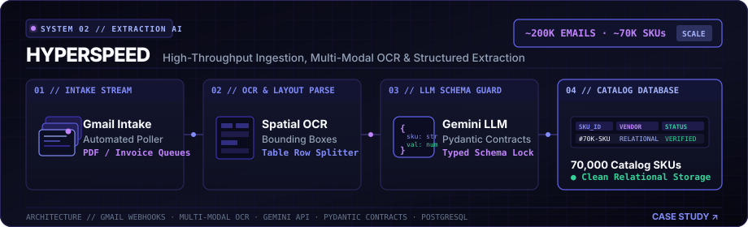



<a href="https://sanjay-078.github.io/sanjay-078/" title="Launch Sanjay Systems — NEXUS-01 Interactive OS">
  <picture>
    <source media="(prefers-color-scheme: dark)" srcset="./assets/nexus-hero-dark.svg">
    <source media="(prefers-color-scheme: light)" srcset="./assets/nexus-hero-light.svg">
    
  </picture>
</a>

  <b>Forward Deployed Systems &amp; Generative AI Engineer</b> · <i>Shipping intelligent architectures that survive enterprise reality.</i> 
   
  <a href="https://sanjay-078.github.io/sanjay-078/"><b>⚡ LAUNCH NEXUS-01 LAB</b></a> &nbsp;·&nbsp;
  <a href="https://sanjay-fde.vercel.app"><b>PORTFOLIO ↗</b></a> &nbsp;·&nbsp;
  <a href="https://www.linkedin.com/in/sanxay/"><b>LINKEDIN ↗</b></a> &nbsp;·&nbsp;
  <a href="mailto:sksubbusanjayai@gmail.com"><b>EMAIL ↗</b></a>

---

### `// PERSPECTIVE`

Frontier generative models only generate durable enterprise value when grounded in deterministic architecture, resilient data pipelines, and audited failure boundaries. As a Forward Deployed Engineer, I specialize in bridging prototype intelligence with operational reality—engineering edge telemetry, high-throughput extraction pipelines, and citation-enforced generative AI that business teams rely upon daily.

---

### `// FLAGSHIP ARCHITECTURES`

Four production-grade systems engineered for tangible operational challenges, verified by audited metrics and live deployments.

 

### 01 · FIREBLADE // MOBILE-TO-CLOUD TELEMETRY
> **Verified Production Outcome:** `20 Employee Phones Deployed in Daily Enterprise Operations · Zero Event Loss`

An edge-to-cloud telephony intelligence pipeline capturing high-frequency call telemetry across mobile fleets. Designed with an offline-first SQLite ring buffer to guarantee zero event loss during spotty field connectivity, streaming securely into a hardened FastAPI gateway and real-time operations dashboard.

  <a href="https://sanjay-fde.vercel.app/work/fireblade" title="Inspect FIREBLADE Case Study">
    <picture>
      <source media="(prefers-color-scheme: dark)" srcset="./assets/fireblade-dark.svg">
      <source media="(prefers-color-scheme: light)" srcset="./assets/fireblade-light.svg">
      
    </picture>
  </a>

<b>System Architecture &amp; Engineering Specification</b>

 

| Layer | Implementation &amp; Protocols |
| :--- | :--- |
| **Mobile Edge Daemon** | Kotlin background service running Android telephony state listeners, capturing call state transitions, audio metadata, and network quality indicators. |
| **Resilient Edge Queue** | Local SQLite ring buffer with exponential backoff retry policies, ensuring zero telemetry loss during connectivity drops. |
| **Ingestion Gateway** | FastAPI reverse-proxy endpoint enforcing TLS 1.3, HMAC request signatures, and per-device rate limiting. |
| **Analytics Engine** | Automated event normalization and Postgres aggregation, feeding executive duration histograms and sentiment metrics. |

**Key Engineering Challenges Overcome:**
- Circumventing Android Doze mode and manufacturer background execution limits without compromising device battery life.
- Handling out-of-order event delivery caused by asynchronous cellular reconnects through sequence monotonic timestamping.

[Read Full FIREBLADE Engineering Case Study ↗](https://sanjay-fde.vercel.app/work/fireblade)

 

---

 

### 02 · HYPERSPEED // EXTRACTION AUTOMATION
> **Verified Production Outcome:** `~200,000 Supplier Emails Processed · ~70,000 Catalog SKUs Extracted`

An automated document intelligence pipeline ingesting high-volume unstructured supplier communications, multi-page PDF catalogs, and non-standard invoice tables. Couples spatial OCR layout analysis with schema-guarded Gemini API extraction to construct a deduplicated, relational enterprise product catalog.

  <a href="https://sanjay-fde.vercel.app/work/hyperspeed" title="Inspect HYPERSPEED Case Study">
    <picture>
      <source media="(prefers-color-scheme: dark)" srcset="./assets/hyperspeed-dark.svg">
      <source media="(prefers-color-scheme: light)" srcset="./assets/hyperspeed-light.svg">
      
    </picture>
  </a>

<b>System Architecture &amp; Engineering Specification</b>

 

| Layer | Implementation &amp; Protocols |
| :--- | :--- |
| **Multi-Stream Intake** | Automated Gmail API webhook poller and multi-threaded attachment ingestor handling MIME types, raw text, and nested PDFs. |
| **Layout Decomposition** | Multi-modal OCR bounding-box segmenter detecting complex invoice tables, multi-column price lists, and irregular scan orientations. |
| **LLM Schema Enforcement** | Gemini API prompted with strict Pydantic data contracts, few-shot schema validation, and self-consistency extraction chains. |
| **Relational Catalog** | Automated deduplication and entity resolution matrix storing clean normalized product records into PostgreSQL. |

**Key Engineering Challenges Overcome:**
- Parsing heavily distorted table structures from low-resolution PDF scans where traditional tabular regex parsers fail.
- Eliminating LLM schema drift and non-deterministic formatting through programmatic runtime type validation and automatic retry prompting.

[Read Full HYPERSPEED Engineering Case Study ↗](https://sanjay-fde.vercel.app/work/hyperspeed)

 

---

 

### 03 · STRATOS // SOURCE-GROUNDED GENERATIVE AI
> **Verified Production Outcome:** `Deterministic Grounding Across 69,070 Catalogue Products · Zero Hallucination`

A hallucination-resistant generative AI assistant engineered for enterprise commerce. Features a hybrid retrieval engine combining dense vector embeddings with BM25 sparse keyword filtering over 69,070 catalogue items, fortified by an optical cross-encoder verification barrier that enforces 100% source SKU attribution before response emission.

  <a href="https://sanjay-fde.vercel.app/work/stratos" title="Inspect STRATOS Case Study">
    <picture>
      <source media="(prefers-color-scheme: dark)" srcset="./assets/stratos-dark.svg">
      <source media="(prefers-color-scheme: light)" srcset="./assets/stratos-light.svg">
      
    </picture>
  </a>

<b>System Architecture &amp; Engineering Specification</b>

 

| Layer | Implementation &amp; Protocols |
| :--- | :--- |
| **Query Intent Encoder** | Dense vector projection translating technical domain queries into normalized 768-dimensional latent representations. |
| **Dual-Index Retrieval** | Hybrid search architecture pairing cosine vector similarity with BM25 sparse keyword indexing over 69,070 catalog items. |
| **Grounding Cross-Encoder** | Strict attribution barrier comparing candidate output tokens against retrieved source chunks; ungrounded assertions are stripped. |
| **Attributed Synthesis** | Generative synthesis emitting structured Markdown responses with cryptographic SKU provenance links and confidence scoring. |

**Key Engineering Challenges Overcome:**
- Eliminating plausible synthetic hallucinations in technical product specifications where incorrect dimensions or ratings carry commercial liability.
- Achieving sub-180ms P99 retrieval latency over dense high-dimensional index spaces using quantized vector clustering.

[Read Full STRATOS Engineering Case Study ↗](https://sanjay-fde.vercel.app/work/stratos)

 

---

 

### 04 · DECIBEL // WORKFLOW ENGINE &amp; CRM
> **Verified Production Outcome:** `3 Business Departments Coordinated · 19/19 Passing End-to-End Test Suites`

A mission-critical operational state machine and cross-department CRM routing commercial inquiries, fulfillment orders, and support tickets. Built with deterministic state transition logic, atomic locking, and an automated continuous test verification harness maintaining 19/19 passing Playwright end-to-end integration test suites.

  <a href="https://sanjay-fde.vercel.app/work/decibel" title="Inspect DECIBEL Case Study">
    <picture>
      <source media="(prefers-color-scheme: dark)" srcset="./assets/decibel-dark.svg">
      <source media="(prefers-color-scheme: light)" srcset="./assets/decibel-light.svg">
      
    </picture>
  </a>

<b>System Architecture &amp; Engineering Specification</b>

 

| Layer | Implementation &amp; Protocols |
| :--- | :--- |
| **Intake Queue &amp; SLA** | Omni-channel enquiry intake with automated tier-based priority scoring and countdown timers. |
| **Finite State Machine** | Deterministic directed acyclic graph (DAG) governing inquiry lifecycle transitions with atomic concurrency locks. |
| **Departmental Queues** | 3 synchronized operational work streams: Commercial Sales Desk, Logistics Fulfillment, and Support Escalation. |
| **Automated Verification** | Continuous integration test suite executing 19 comprehensive Playwright and Jest end-to-end user journey checks. |

**Key Engineering Challenges Overcome:**
- Preventing race conditions and orphaned workflow tickets when multiple department agents concurrently access shared order states.
- Providing full auditability and SLA compliance reporting across disparate legacy enterprise communication channels.

[Read Full DECIBEL Engineering Case Study ↗](https://sanjay-fde.vercel.app/work/decibel)

 

---

### `// NEXUS-01 INTERACTIVE LABORATORY`

The identity hero at the top of this profile represents **NEXUS-01**, an original hardware-inspired artificial intelligence architecture. You can interact directly with simulated companion sub-routines in the dedicated **GitHub Pages Lab**:

[**👋 WAVE PROTOCOL**](https://sanjay-078.github.io/sanjay-078/?mode=wave) &nbsp;·&nbsp; [**⌕ DIAGNOSTIC SCAN**](https://sanjay-078.github.io/sanjay-078/?mode=scan) &nbsp;·&nbsp; [**✦ COGNITIVE THINK**](https://sanjay-078.github.io/sanjay-078/?mode=think) &nbsp;·&nbsp; [**☾ LOW POWER**](https://sanjay-078.github.io/sanjay-078/?mode=sleep)

 

Featuring Apple-inspired OS boot sequencing, tactile telemetry switches, interactive command palette, and local architecture simulations.

---

### `// CORE TOOLING & ENGINEERING STACK`

| Domain | Technologies &amp; Frameworks | Engineering Focus |
| :--- | :--- | :--- |
| **Generative AI &amp; NLP** | Gemini API, Vector Embeddings, RAG Architectures, Spatial OCR, Python | Grounding guardrails, schema enforcement, hallucination prevention |
| **Distributed Systems &amp; Backend** | FastAPI, Python, PostgreSQL, SQLite Edge Queues, REST APIs | Low-latency ingestion, offline buffering, high-concurrency throughput |
| **Frontend &amp; Edge Telemetry** | React, Next.js, TypeScript, Kotlin / Android Services, Modern CSS Systems | Resilient background daemons, executive dashboards, telemetry UI |
| **Quality &amp; Continuous Delivery** | Playwright E2E, Jest, Pytest, Git, Vercel, Schema Validation Matrix | Automated regression testing, SLA verification, zero-loss pipelines |

---

### `// OPERATING PHILOSOPHY`

> *"Software is only real when non-technical operators use it daily without failure."*

1. **Deterministic Grounding:** Enterprise generative AI must reference verified source records. Plausible hallucinations are treated as critical system faults.
2. **Defensive Edge Resiliency:** Software operating on physical hardware or mobile networks must be architected for disconnection, battery throttles, and imperfect humans.
3. **Audited Transparency:** Systems are verified by measurable production outcomes, passing test suites, and explicit failure boundaries.
4. **Deploy Beyond the Demo:** Prototype code is trivial; durable engineering begins when production edge cases arrive.

---

  SANJAY SYSTEMS // NEXUS-01 · ORIGINAL ARCHITECTURAL ASSETS · VERIFIED PUBLIC ENGINEERING DATA
   
  <a href="https://sanjay-fde.vercel.app">sanjay-fde.vercel.app</a> · <a href="https://github.com/sanjay-078">github.com/sanjay-078</a> · <a href="https://www.linkedin.com/in/sanxay/">linkedin.com/in/sanxay</a>

