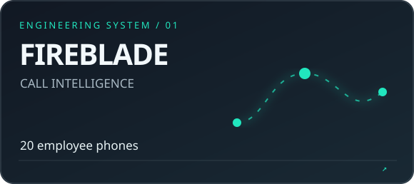
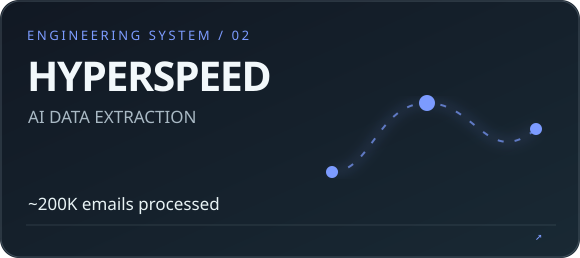
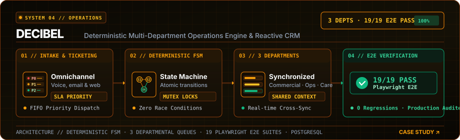

 

**Forward Deployed Engineer · Generative AI Engineer**  
Designing intelligent systems that work beyond the demo.

[**⚡ INTERACT WITH NEXUS-01**](https://sanjay-078.github.io/sanjay-078/) · [**LIVE PORTFOLIO ↗**](https://sanjay-fde.vercel.app) · [**LINKEDIN ↗**](https://www.linkedin.com/in/sanxay/) · [**EMAIL ↗**](mailto:sksubbusanjayai@gmail.com)

---

### `> whoami`

I’m **Sanjay S**, a Forward Deployed Engineer building real-world AI, automation, and full-stack systems. I care about usable products, measurable results, and engineering decisions that survive production.

### `> ./systems --explore`

<table>
<tr>
<td width="50%">
 
Mobile-to-web call intelligence · 20 employee phones in daily use
</td>
<td width="50%">
 
~200,000 emails processed · ~70,000 products extracted
</td>
</tr>
<tr>
<td>
 
Source-grounded AI assistant · 69,070 catalogue products
</td>
<td>
 
Departmental workflows · 19 documented passing E2E checks
</td>
</tr>
</table>

### `> interact --github-native`

**The robot above is animated. These expandable panels are directly interactive on GitHub.** Try launching the robot in a specific mode below; the controls run in the separate GitHub Pages lab.

[**👋 WAVE**](https://sanjay-078.github.io/sanjay-078/?mode=wave) &nbsp;·&nbsp; [**⌕ SCAN**](https://sanjay-078.github.io/sanjay-078/?mode=scan) &nbsp;·&nbsp; [**✦ THINK**](https://sanjay-078.github.io/sanjay-078/?mode=think) &nbsp;·&nbsp; [**☾ REST**](https://sanjay-078.github.io/sanjay-078/?mode=sleep)

🤖 <b>NEXUS-01 // Tell me what you build</b>

 
I build connected AI and automation systems: data-extraction pipelines, source-grounded assistants, field-ready mobile/web tools, and workflow software.

🧠 <b>NEXUS-01 // Reveal the engineering stack</b>

 
<strong>AI & Data:</strong> Gemini API, LLM applications, retrieval-grounding workflows, Python, OCR 
<strong>Backend:</strong> FastAPI, API integrations, SQLite, PostgreSQL, Supabase 
<strong>Frontend:</strong> React, Next.js, TypeScript, Android/Kotlin 
<strong>Delivery:</strong> Git, automated testing, Vercel, production validation

🛰️ <b>NEXUS-01 // Explore how the AI robot works</b>

 
This robot is an original animated SVG. Motion loops on the profile without JavaScript. The full NEXUS-01 interactive control room is a separate HTML/CSS/JavaScript experience powered by GitHub Pages. Its console runs deterministic demo responses rather than pretending to be connected to a production AI model.
  
<a href="https://sanjay-078.github.io/sanjay-078/">Open the interactive robot control room ↗</a>

---

NEXUS-01 / custom-built profile identity · visual assets are original · all project demos use synthetic or approved public information
 
<a href="https://sanjay-fde.vercel.app">sanjay-fde.vercel.app</a> · <a href="https://github.com/sanjay-078">github.com/sanjay-078</a>

